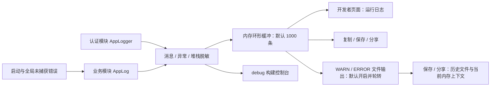

# 运行日志与错误记录

## 记录流程

认证模块使用 [`AppLogger`](../../lib/utils/app_logger.dart)，业务模块使用 [`AppLog`](../../lib/utils/app_log.dart)。两者共享同一个缓冲和导出入口，通过 `LogCategory` 区分来源，避免分成两套日志后丢失认证失败与业务请求之间的时间顺序。



一条记录包含时间、分类、级别、模块 tag、操作说明，以及可选的异常详情和堆栈。认证日志的分类是 `authentication`；业务和运行错误的分类是 `business`。分类与级别独立，认证失败仍属于认证日志。

图片失败按当前展示的图片来源去重，只记录首次错误和堆栈；父级重建不会重复写入，更换图片来源后可以再次记录。全局未捕获错误的消息、异常详情和堆栈共享 2000 字符上限，先脱敏再截断，避免超长组件上下文挤占诊断窗口。

启动前使用 `AppLog.bootstrapLogger`，原生平台在 DI 装配前按已保存的开关初始化文件输出，并补写缓冲中的警告与错误；开关无法读取时仅保留内存日志。DI 注册时沿用同一实例，启动失败会等待已接受的记录刷新后展示恢复页。Web 仅保留内存日志，不注册 isolate 错误端口或启用文件输出。业务门面每次取当前注册实例，避免测试或重新装配后日志写入旧对象。

## 错误记录约定

- 捕获真实异常时记录 `ERROR`，同时传入 `error` 和 `stackTrace`，再保持原来的状态更新、回退或异常传播行为。
- 返回失败状态、HTTP 错误、图片加载失败、平台回调失败等没有 Dart 异常的路径也必须记录。不能只用 `debugPrint` 或设置错误文案。
- 无本地 `catch` 的异步操作可以用 `AppLog.guard`；认证操作可以用 `AppLogger.guard`。它们记录后重抛原异常，不增加业务重试。
- 公共 API 包装记录最终失败，首次会话失效后成功恢复可以记录 `WARN`。第二课堂仍仅针对明确的认证过期重试，避免重复提交报名等操作。
- 用户取消下载、关闭验证码或系统选择器、不支持的平台，以及解析器尝试兼容格式的正常分支不视为操作失败。兼容后仍不能完成操作时应记录最终错误。
- [`setupGlobalErrorHandlers()`](../../lib/utils/app_error_reporter.dart) 记录 Flutter 框架错误和根 isolate 未捕获异步错误，保留此前的错误处理器。本地错误记录仍负责补充功能和操作上下文。

```dart
try {
  await loadData();
} catch (error, stackTrace) {
  AppLog.e('GradesProvider', '加载成绩失败',
    error: error, stackTrace: stackTrace);
  // 保持原有错误状态、提示或重抛逻辑。
}
```

记录覆盖查询及缓存（成绩、培养方案、修读情况、考试、教室、课表、体测、网络设备、用户信息、研究生服务）、第二课堂、办事大厅、缴费余额、报修、课表编辑及导入导出、校历和节假日、通知 WebView 及附件下载、小组件、更新、背景图片及主题色、图标、桌面窗口、存储清理和开发者工具。一个错误在 API 与界面边界可以留下不同上下文的记录，不保证每个异常恰好一条。

## 查看与导出

开发者页面的“运行日志”提供“全部”“认证日志”“业务错误”三个视图。业务错误视图显示 `business` 分类下的 `WARN` 和 `ERROR`，并可继续按级别与 tag 筛选。堆栈可展开查看，tag 列表随缓冲实时更新。

复制导出当前进程的整个内存缓冲。保存和分享还会按旧到新的顺序包含当前及轮转历史文件，并重新脱敏，重启后也可导出此前的错误。启动失败恢复页也提供复制、保存和分享入口，DI 未装配时使用启动缓冲。历史文件与当前内存上下文分段展示，两段可能包含同一条记录；已有手动快照不会再次合入。快照名为 `bugaoshan-export-{timestamp}.log`，与轮转文件一同位于临时/外部缓存目录的 `Bugaoshan/logs/`；新导出时保留最近 5 份自动命名的快照。本机轮转文件的约 6 MB 上限不包含手动导出快照。用户反馈路径中的查看器和落盘状态文案提供中英文翻译。

连续输出默认开启，仅写入 `WARN` 和 `ERROR`，采用单写入队列和 2 MB × 3 份轮转。阈值按 UTF-8 字节计数，每份允许超出一条完整记录。文件写入、开关、清理及导出共用串行操作链，快速切换后以最后一次开关意图为准。开发者页面可关闭落盘；关闭时删除轮转文件，保留已导出的快照。清除所有数据后按重置后的开关状态恢复落盘。

文件输出失败时保留用户开启意图并显示故障原因；日志系统自身的错误只留在内存，避免递归写入失败的文件。每批写入前后检查当前文件路径，缓存清理移除文件时关闭旧句柄并重建，刷新期间被移除的记录仍可补写。最多连续自动恢复 3 次，实际记录成功写入后才重置计数，耗尽次数后可通过开关手动重试。队列在成功刷新前保留记录，部分写入后重试可能产生重复记录；队列始终有 2000 条上限，不阻塞业务，累计丢弃记录数显示在开发者页面的落盘状态中。WARN 仍默认落盘；会话重建和在线数据回退等可恢复路径省去重复堆栈，最终失败仍记录完整 ERROR。办事大厅的 HTML 错误页只记录脱敏后的短标题和响应长度，不记录正文。

内存日志只在当前进程内保留，超出容量时淘汰旧记录；进程退出后可通过落盘日志排查错误。清空内存不会删除历史文件，自动轮转、关闭落盘、清除所有数据和系统清理缓存会影响可追溯窗口。Dart 的全局处理器不接管原生进程崩溃或被操作系统终止的情况。

## 隐私

消息、异常与堆栈在存储前统一脱敏，包括 token、重置凭据、密码、Bearer、OAuth 参数和账号标识。`FormatException` 仅保留 message 与 offset，不输出可能含个人信息的原始 source。

不主动写入凭据、完整表单、原始个人数据或响应正文。办事大厅记录字段数量、数据类型和响应长度；异常仍保留可诊断的原因与堆栈。脱敏规则不能代替调用方对日志内容的选择。
