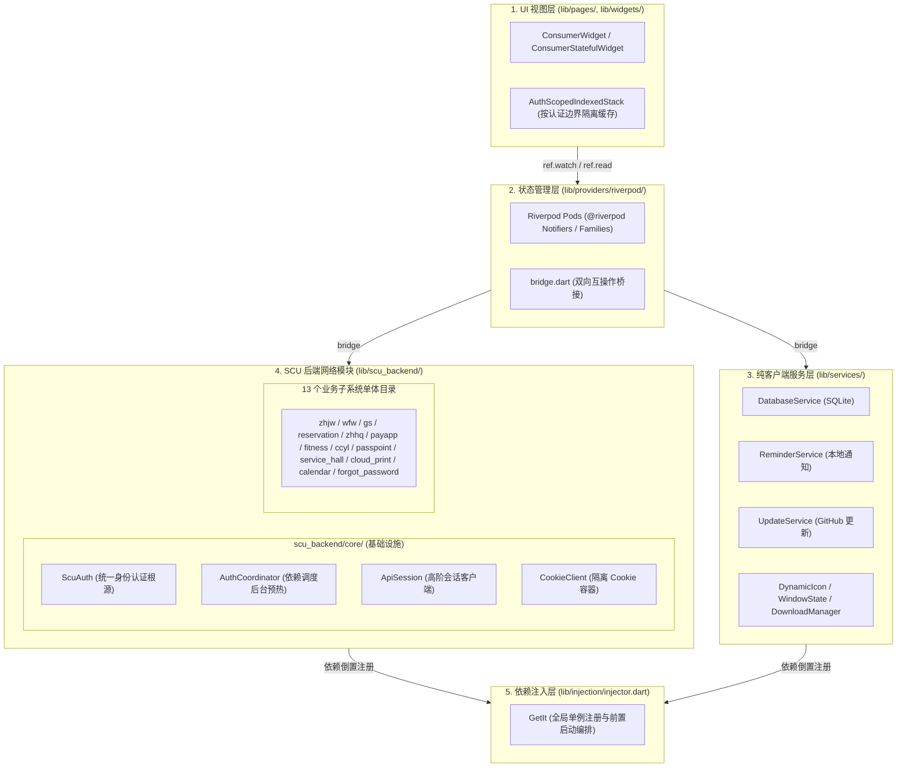

# 现代化状态管理与 SCU 后端架构

> 文档状态：当前实现的权威说明
>
> 最后核对：2026-10-31
>
> 关联文档：[认证架构](authentication.md) · [运行日志](logging.md)

---

## 1. 概述与背景

随着 Bugaoshan 功能模块的持续扩展，早期采用的 `ChangeNotifier` / `ValueNotifier` + `GetIt` 状态层以及散落在 `lib/services/` 下的网络代码逐渐显现出以下架构瓶颈：

1. **状态监听粒度粗、嵌套层级深**：例如 `HomePage` 与全局配置项需依赖层层嵌套的 `ListenableBuilder` / `ValueListenableBuilder`，任一配置变更容易引发整页无谓的重建。
2. **并发时序控制繁重且侵入 UI**：为了防止异步网络请求响应顺序倒挂（如旧的查询比新的查询后返回覆盖有效结果），各业务 Provider 手动维护大量 `_generation`、`_queryEpoch`、`_jobsRevision`、`_operationGeneration` 计数器，甚至泄露至 UI 弹窗与页面代码中（如 `sessionGeneration`）。
3. **网络层样板代码分散重复**：各个 API Service 重复编写 URL 拼接、Headers 组装、HTTP 302 重定向拦截、401/403/登录页探测、JSON 反序列化与未授权自愈逻辑。
4. **服务目录职责混杂**：四川大学专用业务（教务、微服务、第二课堂、智慧后勤、体测、研工、办事大厅等）与纯客户端本地服务（SQLite 数据库、本地提醒通知、窗口状态管理、动态图标等）混杂在 `lib/services/`，且认证类（`auth/`）与数据服务类（`api/`）物理割裂。

为此，工程完成了全方位的现代化改造：
- **状态层**：引入 `flutter_riverpod` + `riverpod_annotation`，将业务与配置状态全面重构为精细化 Riverpod Pods，彻底移除业务与 UI 层的代数检查样板；
- **网络层**：抽象并落地面向业务的高阶会话客户端 **`ApiSession`**；
- **目录架构**：将所有四川大学网络与认证实现抽离至独立的 **`lib/scu_backend/`**，按业务子系统单体化归属。

---

## 2. 总体分层架构

改造后系统形成了职责清晰的五层架构：



各层边界原则：
- **`lib/scu_backend/`**：只关注四川大学各后端接口协议、认证鉴权、数据加解密与 JSON 解析，不持有任何 UI 状态。
- **`lib/services/`**：仅承载设备级、操作系统级或通用开源服务（如 SQLite、原生窗口、更新检测），不掺杂任何四川大学专有网络请求。
- **`lib/providers/riverpod/`**：纯粹的状态与业务逻辑控制，向下消费服务，向上向 Widget 提供响应式绑定。

---

## 3. 状态管理现代化 (Riverpod)

### 3.1 状态细粒度拆解与精准渲染

原架构下庞大的 `AppConfigProvider`（持有多达 25 个 `ValueNotifier` 字段）被拆解为细粒度的状态 Pods（位于 `lib/providers/riverpod/settings/app_config_pods.dart`）：
- `themeColorProvider`、`themeColorModeProvider`、`localeProvider`、`dockItemsProvider`、`visibleDockIdsProvider` 等彼此独立；
- 页面（如 `HomePage`）重构为 `ConsumerStatefulWidget`，仅通过 `ref.watch(visibleDockIdsProvider)` 监听底部 Dock 栏变更，其他与外观无关的设置项变更不再引发导航容器的重绘。

### 3.2 废弃 Provider 的清理

随着状态全面转向 Riverpod，5 个历史遗留的旧 `ChangeNotifier` 文件及其对应测试被彻底移除：
- `lib/providers/network_device_provider.dart`
- `lib/providers/passpoint_provider.dart`
- `lib/providers/classroom_provider.dart`
- `lib/providers/fitness_test_provider.dart`
- `lib/providers/user_info_provider.dart`

对应的 DI 注册从 `lib/injection/injector.dart` 剔除，注销清空回调统一收敛。单元测试套件直接基于 `ProviderContainer` 与桥接 Provider 对 Riverpod Notifier（如 `networkDevicesProvider`、`passpointProvider`、`classroomAvailabilityProvider`、`userInfoProvider`）进行细粒度状态断言。

---

## 4. 并发控制与代数检查消除

### 4.1 业务状态层的天然时序保护

在旧架构中，异步数据加载往往需要手动维护一个整数纪元：
```dart
// 旧写法：易漏、侵入且繁琐
int _queryEpoch = 0;

Future<void> fetch() async {
  final epoch = ++_queryEpoch;
  final data = await api.query();
  if (epoch != _queryEpoch) return; // 手动防倒挂
  state = data;
}
```

在 Riverpod 架构下，该类样板代码被完全消除：
1. **自动取消与生命周期管理**：当依赖发生变化或组件卸载时，Riverpod 会触发取消或重新派发 `build()`；
2. **`AsyncValue` 状态单向推进**：同一 Notifier 重建时，旧的异步执行结果不会写入新实例的内部状态；
3. **针对性清理**：
   - **`CloudPrintProvider`**：删除了 `_generation`、`_jobsRevision`、`_scansRevision` 与公开的 `sessionGeneration`，改为利用 `_jobsFuture` / `_scansFuture` 判定正在执行的异步 Future 唯一性；
   - **`CloudPrintPage` / `Dialog` / `ScansTab`**：移除了向 UI 泄露的 `sessionGeneration` 校验，改为标准的 Flutter `mounted` 校验与列表项存在性检查；
   - **`ZhhqRepairProvider`**：移除了 `_generation`、`_operationGeneration`、`_isCurrent`。

全局的 `sessionGeneration`、`queryEpoch` 与 `operationGeneration` 彻底清零。

### 4.2 认证层核心边界防护（明确保留）

在纯业务状态层消除代数检查的同时，**系统严格保留了 5 处位于核心认证与安全边界处的纪元防护**：

| 位置 | 字段 | 守护意图 |
|---|---|---|
| `ScuAuth` | `_authEpoch` | 用户调用 `logout()` 立即递增，使正在执行的 `_doRefresh()`、`bindSession()` 或 `autoLogin()` 在完成时放弃把新 token 写回持久化，防止登出被静默撤销。 |
| `CcylAuth` | `_authGeneration` | 第二课堂 OAuth 授权与过期重登录期间，若用户登出或 SCU 账号变化，新旧 generation 与 principal 校验失败，旧结果直接抛弃。 |
| `AuthCoordinator` | `_epoch` | 调度多模块预热及延迟补热期间，若触发新一轮预热或用户登出 `invalidateAll()`，旧退避重试直接跳过。 |
| `CloudPrintAuth` | `_generation` | 云打印 SSO 跨多域多跳跳转期间，若根认证失效，完成时拒绝缓存旧会话。 |
| `AuthScopedIndexedStack` | `_authGeneration` | 当认证状态跨越登录/未登录边界时，递增代数并以 `KeyedSubtree(key: ValueKey('auth-$_authGeneration-$id'))` 强制 Flutter 销毁各 Tab 子树的全部 State，杜绝前一账号的敏感内存状态残留。 |

---

## 5. SCU 后端模块与 ApiSession

### 5.1 `lib/scu_backend/` 子系统单体化

所有与四川大学网络访问相关的 45 个源码文件被聚合到 `lib/scu_backend/`，按业务子系统单体化划分：

| 目录 | 对应子系统 | 涵盖文件 |
|---|---|---|
| **`core/`** | 统一认证基座与网络核心 | `scu_auth.dart`, `cookie_client.dart`, `auth_coordinator.dart`, `auth_state.dart`, `subsystem_auth.dart`, `sso_relay_auth.dart`, `api_session.dart`, `api_request.dart`, `scu_exceptions.dart` |
| **`zhjw/`** | 本科综合教务系统 | `zhjw_auth.dart`, `zhjw_api_service.dart`, `zhjw_html_parsers.dart` |
| **`wfw/`** | 移动微服务平台 | `wfw_auth.dart`, `wfw_api_service.dart` |
| **`gs/`** | 研究生管理系统 | `gs_auth.dart`, `gs_api_service.dart`, `graduate_schedule_capture.dart`, `gs_json_envelope.dart` |
| **`reservation/`** | 青春川大场馆预约系统 | `reservation_auth.dart`, `reservation_api_service.dart` |
| **`zhhq/`** | 智慧后勤在线报修系统 | `zhhq_auth.dart`, `zhhq_api_service.dart`, `zhhq_crypto.dart` |
| **`payapp/`** | 财务缴费平台（寝室电费/空调） | `payapp_auth.dart`, `payapp_api_service.dart`, `balance_query_service.dart` |
| **`fitness/`** | 体质测试查询系统 | `fitness_auth.dart`, `fitness_api_service.dart` |
| **`ccyl/`** | 第二课堂活动系统 | `ccyl_auth.dart`, `ccyl_oauth_service.dart`, `ccyl_api_service.dart`, `ccyl_service.dart` |
| **`passpoint/`** | 校园网设备与无感认证 | `new_service_auth.dart`, `new_service_api_service.dart` |
| **`service_hall/`** | 网上办事大厅动态服务 | `service_auth.dart`, `service_api_service.dart`, 表单与插件模型系列文件 |
| **`cloud_print/`** | 校园云打印服务 | `cloud_print_auth.dart`, `cloud_print_api_service.dart` |
| **`calendar/`** | 校历数据服务 | `academic_calendar_service.dart` |
| **`forgot_password/`** | 统一认证找回密码 | `forgot_password_service.dart` |

### 5.2 `ApiSession` 会话客户端 (`lib/scu_backend/core/api_session.dart`)

`ApiSession` 是面向业务 API 的高阶会话操作客户端，它封装了以下核心职责：

1. **生命周期绑定与重认证自愈**：持有 `getClient` 与 `invalidate`，通过 `run<T>()` 统一由底层 `retryOnUnauthenticated` 驱动；
2. **智能路径解析 (`resolveUri`)**：自动合并 Base URL、相对路径、绝对路径及 Query Parameters；
3. **请求头管理**：统一注入 `kDefaultUserAgent`、`Accept`、`X-Requested-With: XMLHttpRequest` 以及子系统定制头；
4. **分层异常判定**：
   - HTTP 级：302 重定向、401/403 状态码、空 Body、`looksLikeLoginPage(body)`；
   - 业务级信封拦截：通过 `jsonValidator` 检查业务返回码（如微服务 `e == 10013`、预约系统 `e == 'UN_AUTH'`、体测 `登录信息失效`），命中时抛出 `UnauthenticatedException` 触发认证自愈链路。
5. **类型化动词**：
   - `getHtml`：拉取 HTML 页面，校验并去除前后空格；
   - `getJsonMap` / `getJsonList` / `getJson`：安全请求并解码 JSON 结构；
   - `postFormForJsonMap` / `postJsonForJsonMap`：标准表单与 JSON 格式的 POST 提交并解析响应。

重构后，各个 API Service 不再手写底层 HTTP 客户端拼装和重试逻辑，平均代码行数减少 60% 以上，且完全保留构造参数向后兼容性与测试替身注入能力。

---

## 6. 验证指标

| 维度 | 指标 | 结果 |
|---|---|---|
| **代码静态分析** | `dart analyze --fatal-infos lib test` | **0 errors, 0 warnings, 0 infos** 全部通过 |
| **测试套件回归** | `flutter test` | **1151 passed, 1 skipped, 0 failed** 全部通过 |
| **代码规模净化** | 业务与废弃代码净减少 | **-2339 行** 废弃样板与旧 Provider 代码 |
| **非 Auth 代数检查** | `sessionGeneration` / `queryEpoch` / `operationGeneration` | **0 处** 完全清除 |
| **Auth 边界保护** | 核心 Auth Epoch 纪元检查 | **5 处** 显式受控保留 |
